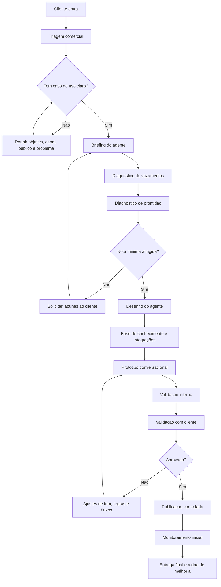

# Processo de entrada de clientes para criação de agentes de IA

## Objetivo

Organizar a entrada de novos clientes para que cada agente de IA seja criado com contexto suficiente, responsabilidades claras, critérios de qualidade e próximos passos objetivos.

O processo abaixo foi inspirado no modelo do GPT Maker: cada agente começa com uma prévia, recebe uma nota de prontidão e avança conforme lacunas são preenchidas.

Mais do que configurar um agente, o onboarding deve funcionar como um diagnóstico comercial da operação. A lógica é:

Pergunta -> identifica gargalo -> mede impacto -> traduz em dinheiro -> mostra onde a IA pode atuar.

## Fluxo geral



## Etapas do onboarding

### 1. Triagem comercial

Objetivo: entender rapidamente se o cliente tem um problema adequado para agente de IA.

Perguntas essenciais:

- Qual processo você quer automatizar ou apoiar com IA?
- O agente vai atender clientes, vender, qualificar leads, tirar dúvidas, operar processos internos ou outra coisa?
- Quem vai conversar com o agente?
- Em qual canal ele vai operar: WhatsApp, site, Instagram, CRM, Slack, e-mail ou outro?
- Qual seria um bom resultado nos primeiros 30 dias?
- O que o agente nunca pode fazer?

Saída esperada:

- Caso de uso definido.
- Dono interno do projeto definido.
- Canal principal definido.
- Critério de sucesso inicial definido.

### 2. Briefing do agente

Objetivo: capturar as informações necessárias para criar a personalidade, o escopo e a lógica do agente.

Campos obrigatórios:

- Nome do agente.
- Empresa.
- Site e materiais públicos.
- Produto ou serviço principal.
- Público atendido.
- Objetivo do agente.
- Canal de atuação.
- Tom de voz.
- Principais responsabilidades.
- Assuntos permitidos.
- Assuntos proibidos.
- Regras de encaminhamento para humano.
- Informações que o agente precisa coletar.
- Sistemas que precisam ser consultados ou atualizados.
- Exemplos de boas conversas.
- Exemplos de conversas ruins ou proibidas.

### 3. Diagnóstico de vazamentos

Objetivo: fazer o cliente enxergar onde a operação perde velocidade, dinheiro, previsibilidade ou qualidade.

O diagnóstico deve investigar pelo menos estes pontos:

| Vazamento | Pergunta central | Impacto que calculamos |
| --- | --- | --- |
| Demora na primeira resposta | Quanto tempo um lead espera até receber resposta? | Leads potencialmente perdidos |
| Fora do horário | Quantos contatos chegam quando ninguém atende? | Receita não trabalhada |
| Falta de follow-up | Quantos leads param sem nova tentativa? | Pipeline desperdiçado |
| Atendimento sem padrão | Cada pessoa responde de um jeito? | Conversão e experiência |
| Erro humano | Quantos pedidos ou orçamentos voltam com erro? | Retrabalho e prejuízo |
| Lead sem qualificação | Vendedor fala com todo mundo? | Tempo comercial desperdiçado |
| Falta de CRM | Quantos leads somem do radar? | Pipeline invisível |
| Resposta incompleta | Cliente precisa perguntar várias vezes? | Atrito e abandono |
| Falta de priorização | Lead quente entra na mesma fila? | Oportunidade perdida |
| Handoff ruim | Cliente precisa repetir tudo para o humano? | Atrito e abandono |
| Base parada | Contatos antigos são reativados? | Receita parada |
| Atendimento limitado | A operação só funciona em horário comercial? | Demanda reprimida |

### 4. Diagnóstico de prontidão

Objetivo: transformar o briefing em uma nota objetiva antes de começar a construção.

Escala sugerida: 0 a 10.

#### O básico: 2,5 pontos

- Instruções do agente: 0,8
- Sobre a empresa: 0,5
- Objetivo do agente: 0,5
- Canal conectado ou definido: 0,4
- Rosto, nome ou identidade do agente: 0,3

#### O que ele faz: 3 pontos

- Responsabilidades claras: 1,0
- Fluxo principal mapeado: 0,7
- Critérios de qualificação ou decisão: 0,5
- Regras de escalonamento para humano: 0,4
- Mensagens de retomada ou follow-up: 0,4

#### Conhecimento: 2 pontos

- Site, documentos ou FAQ: 0,7
- Objeções e dúvidas frequentes: 0,4
- Políticas comerciais ou operacionais: 0,3
- Exemplos reais de conversas: 0,3
- Limites do que não responder: 0,3

#### Integrações e operação: 1,5 ponto

- Canal de atendimento: 0,4
- CRM, planilha ou sistema de registro: 0,4
- Agenda, pagamento ou outro sistema crítico: 0,3
- Dono interno para aprovar respostas: 0,2
- Rotina de monitoramento definida: 0,2

#### Validação: 1 ponto

- Cenários de teste definidos: 0,4
- Critérios de aprovação definidos: 0,3
- Plano de publicação controlada: 0,2
- Métrica de sucesso definida: 0,1

Notas de corte:

- 0 a 3,9: briefing insuficiente. Não construir ainda.
- 4 a 6,9: construir apenas protótipo simples.
- 7 a 8,4: pronto para MVP.
- 8,5 a 10: pronto para publicação controlada.

## Diagnóstico de impacto operacional e financeiro

Essa camada deve entrar durante o briefing, principalmente com leads novos. Ela não serve para prometer resultado; serve para mostrar exposição potencial e priorizar onde a IA pode atuar primeiro.

Frase padrão:

> Com os dados informados, existe uma exposição potencial de até R$ X por mês nessa etapa. Isso não significa que todo esse valor será recuperado, mas mostra onde a operação pode estar deixando oportunidade escapar.

### 1. Tempo de resposta

Perguntas:

- Quantos leads entram por mês?
- Qual é o tempo médio da primeira resposta?
- Existe diferença entre horário comercial e fora do horário?
- Quantos leads entram depois das 18h?
- Quantos entram aos finais de semana?
- Quantos acabam sem resposta?
- Vocês conseguem medir quantos deixam de responder depois da primeira mensagem?

Cálculo:

```text
Leads afetados x taxa de conversão histórica x ticket médio = receita potencial exposta
```

Exemplo:

```text
540 leads fora do horário x 8% de conversão x R$ 3.500 de ticket = R$ 151.200 expostos/mês
```

### 2. Follow-up

Perguntas:

- Dos leads que não compram no primeiro contato, o que acontece depois?
- Existe follow-up em D+1, D+2, D+3, D+7 ou D+15?
- Quem faz esse acompanhamento?
- É manual ou automático?
- Existe lembrete?
- Existe CRM?
- Se o vendedor esquecer, alguém percebe?
- Quantos leads ficam parados hoje sem acompanhamento?

Cálculo:

```text
Leads abandonados x taxa de conversão esperada x ticket médio = pipeline potencial abandonado
```

Exemplo:

```text
600 leads abandonados x 8% de conversão x R$ 3.500 de ticket = R$ 168.000 expostos/mês
```

### 3. Atendimento fora do horário

Perguntas:

- Qual é o horário atual de atendimento?
- Quantos leads chegam fora dele?
- O cliente recebe alguma resposta automática ou humana?
- Existe alguém de plantão?
- Quanto tempo leva até esse lead ser respondido?
- No dia seguinte esses leads têm prioridade?

Leitura consultiva:

Atendimento fora do horário não é apenas “responder de madrugada”. É infraestrutura para proteger oportunidades que entram quando a equipe não está disponível.

### 4. Qualificação ruim

Perguntas:

- Quantas pessoas fazem atendimento comercial?
- Quantos leads cada uma atende?
- Quanto tempo gastam, em média, por lead?
- Quantos leads não têm perfil?
- Em que ponto descobrem isso?
- O vendedor precisa fazer muitas perguntas antes de perceber que não existe fit?

Cálculo operacional:

```text
Leads sem fit x minutos gastos por lead = horas comerciais desperdiçadas
```

Exemplo:

```text
200 leads sem fit x 15 minutos = 3.000 minutos = 50 horas/mês
```

Insight:

O maior impacto não costuma ser apenas custo salarial. São horas comerciais que poderiam estar sendo usadas em oportunidades qualificadas.

### 5. Retrabalho

Perguntas:

- Quantos pedidos precisam ser corrigidos?
- Quantos orçamentos voltam por informação incompleta?
- Quantos clientes enviam endereço, produto, quantidade ou pagamento incorretos?
- Quantas vezes o vendedor precisa perguntar a mesma coisa?
- Quanto tempo a equipe gasta corrigindo isso?

Impactos:

- Horas perdidas.
- Custo operacional.
- Atraso.
- Experiência ruim.
- Risco de erro comercial.

### 6. Conversas abandonadas

Perguntas:

- Quantos clientes começam atendimento e desaparecem antes de concluir?
- Em qual etapa isso acontece?
- Depois de qual pergunta?
- Depois de esperar quanto tempo?
- Depois de receber preço?
- Durante cadastro?
- Durante orçamento?

Uso para IA:

- Reduzir fricção.
- Fazer uma pergunta por vez.
- Retomar no momento certo.
- Encaminhar para humano quando houver sinal de compra.

### 7. Leads quentes tratados como frios

Perguntas:

- Hoje existe algum mecanismo para diferenciar curiosidade de intenção real de compra?
- Um lead grande fura fila?
- Quem recebe alerta quando surge uma oportunidade de alto valor?
- Existe lead scoring?

Exemplo:

```text
Lead A: "Vocês entregam em Curitiba?"
Prioridade: baixa ou média.

Lead B: "Tenho três unidades e consumo 2.000 unidades por semana. Quero orçamento."
Prioridade: altíssima.
```

A IA deve conseguir classificar, registrar e notificar o time quando uma oportunidade forte aparecer.

### 8. Base parada

Perguntas:

- Quantas pessoas já falaram com vocês nos últimos 12 meses e não compraram?
- Quantas estão no CRM?
- Quantas podem ser reativadas?
- Vocês fazem campanha de reativação?
- Com que frequência?
- Existe segmentação por motivo da perda?

Cálculo:

```text
Base reativável x taxa estimada de reativação x taxa de fechamento x ticket médio
```

Exemplo:

```text
12.000 contatos antigos x 2% reativados = 240 oportunidades
240 x 20% de fechamento = 48 vendas
48 x R$ 2.000 = R$ 96.000
```

## Índice de maturidade da operação

Além da nota do agente, cada cliente deve receber um score da operação. Isso deixa a reunião mais consultiva e ajuda a priorizar o primeiro agente.

Áreas avaliadas:

- Atendimento.
- Tempo de resposta.
- Follow-up.
- Qualificação.
- CRM.
- Automação.
- Disponibilidade.
- Padronização.
- Dados.
- Handoff.
- Base de conhecimento.
- Métricas.

Exemplo:

| Área | Nota |
| --- | ---: |
| Atendimento | 7/10 |
| Follow-up | 3/10 |
| Qualificação | 5/10 |
| CRM | 4/10 |
| Automação | 2/10 |
| Disponibilidade | 4/10 |
| Padronização | 6/10 |
| Dados | 3/10 |

Resultado:

```text
Índice de maturidade operacional: 34/80
Maturidade normalizada: 42%
Maior oportunidade identificada: follow-up
Segundo gargalo: disponibilidade
Terceiro gargalo: qualificação
```

## Perguntas consultivas que geram consciência

Evitar perguntas frias como “você possui CRM?” quando for possível fazer o cliente perceber o problema.

Perguntas melhores:

- Quando um cliente para de responder hoje, como vocês sabem que precisam procurá-lo novamente?
- Se entrarem 100 leads às 22h de sábado, o que acontece com eles?
- Se eu falar com três vendedores diferentes, vou receber a mesma orientação, preços e condições?
- Quanto tempo seu vendedor leva para perceber que está falando com alguém que nunca teria perfil para comprar?
- Quantos leads entram por mês e simplesmente desaparecem do radar?
- Quanto dinheiro vocês investem para gerar leads que depois ninguém acompanha?
- Se seu melhor vendedor faltar amanhã, o padrão de atendimento continua o mesmo?
- Quantos clientes recebem resposta quando entram em contato às 23h?
- Se um cliente disser “me chama daqui 15 dias”, qual mecanismo garante que isso realmente vai acontecer?

## Estrutura recomendada do processo Avraham

O briefing mestre não deve ser entregue inteiro ao cliente como um formulário de 130 perguntas. Ele deve ser um checklist interno.

Para o cliente, o ideal é transformar tudo em aproximadamente 35 perguntas inteligentes, com perguntas condicionais.

### 1. Formulário pré-kickoff

Coleta dados objetivos:

- Empresa.
- Segmento.
- Produtos.
- Horários.
- Sistemas.
- Canais.
- Documentos.
- Responsáveis.
- Volume de atendimento.
- Ticket médio.
- Conversão média.

### 2. Reunião de briefing operacional

Aqui entram as perguntas de operação real:

- O que acontece quando isso ocorre?
- E depois?
- Quem decide?
- Existe exceção?
- O que dá problema hoje?
- Quando precisa chamar humano?

### 3. Análise de conversas reais

Usar conversas de WhatsApp para extrair:

- Intenção.
- Pergunta.
- Regra.
- Decisão.
- Resposta.
- Resultado.
- Lacuna.
- Oportunidade de automação.

Coleta recomendada:

- 5 ótimos atendimentos.
- 5 atendimentos ruins.
- 5 situações complexas.
- 5 conversas comuns.

### 4. Documento operacional do agente

O briefing vira um Mapa do Agente:

- Objetivo.
- Personagem.
- Intenções.
- Fluxos.
- Qualificação.
- Produtos.
- Base de conhecimento.
- Regras.
- Ferramentas.
- Integrações.
- Handoff.
- Exceções.
- Proibições.
- CRM.
- Follow-ups.
- Métricas.
- Testes.

## Briefing inteligente para o cliente

Usar como versão enxuta em formulário ou entrevista. As perguntas condicionais aprofundam conforme o tipo de agente.

### Bloco 1: operação

1. O que a empresa vende ou entrega?
2. Quem normalmente entra em contato pelo WhatsApp?
3. Por quais motivos as pessoas normalmente chamam vocês?
4. Quantos atendimentos vocês recebem por mês?
5. Em quais horários há maior volume?
6. Hoje, quantas pessoas atendem esses contatos?
7. Existe divisão entre vendas, suporte, financeiro, atendimento ou operação?

### Bloco 2: objetivo do agente

8. Qual problema principal vocês querem resolver com IA?
9. O que acontece hoje que vocês gostariam que deixasse de acontecer?
10. O agente será responsável por atendimento, qualificação, vendas, pedidos, agendamento, suporte, cobrança, pós-venda ou triagem?
11. O que seria considerado uma conversa bem-sucedida?
12. Qual deve ser o resultado final esperado?

### Bloco 3: vazamento e impacto

13. Quantos leads ou contatos entram por mês?
14. Qual é o ticket médio ou valor médio de venda?
15. Qual é a taxa média de conversão?
16. Quantos contatos chegam fora do horário?
17. Quantos ficam sem resposta ou sem continuidade?
18. Hoje existe follow-up definido?
19. Quantos leads param sem segunda ou terceira tentativa?
20. Quanto tempo o time gasta com contatos sem fit?

### Bloco 4: fluxo real

21. Imagine que eu sou um cliente entrando em contato agora. O que acontece do primeiro “oi” até a finalização?
22. Quais informações precisam ser coletadas?
23. Existe uma ordem obrigatória?
24. Em que momento vocês entendem que aquele cliente está qualificado?
25. O que acontece depois disso?
26. Quem assume quando precisa de humano?

### Bloco 5: regras e limites

27. Quais regras de negócio nunca podem ser quebradas?
28. O que a IA jamais pode dizer, prometer ou fazer?
29. Em quais situações o agente deve chamar uma pessoa?
30. Existe alguma informação que muda com frequência?
31. Qual é a fonte oficial quando houver conflito de informação?

### Bloco 6: conhecimento e exemplos

32. Quais são as 20 a 30 perguntas que a equipe mais responde hoje?
33. Quais produtos, serviços, condições ou políticas o agente precisa conhecer?
34. Envie conversas reais boas, ruins, comuns e complexas.
35. Quais situações vocês obrigatoriamente querem testar antes de liberar a IA?

## Blocos condicionais

### Se o agente faz vendas

- Quais são os principais argumentos comerciais?
- Por que o cliente compra de vocês?
- Quais são os diferenciais contra concorrentes?
- Quais objeções aparecem?
- O agente pode fazer upsell ou cross-sell?
- Pode mencionar urgência, promoção, desconto ou garantia?

### Se o agente qualifica leads

- O que caracteriza um cliente ideal?
- O que caracteriza um cliente sem fit?
- Quais dados são obrigatórios para qualificar?
- Quais respostas mudam completamente a abordagem?
- Quando um lead deve furar fila?

### Se o agente faz pedidos

- Quais produtos podem ser pedidos?
- Existem adicionais, combinações ou restrições?
- Existe pedido mínimo?
- O agente pode confirmar preço, estoque e prazo?
- Como funciona pagamento, entrega, cancelamento e alteração?

### Se o agente faz suporte

- Quais problemas ele pode resolver sozinho?
- Quais problemas exigem humano?
- Quais dados precisa coletar antes de abrir chamado?
- Existe prioridade por tipo de problema?
- Existe prazo de resposta?

### Se o agente agenda

- Quem pode ser agendado?
- Quais horários estão disponíveis?
- Existe duração padrão?
- O agente pode remarcar ou cancelar?
- Quais informações precisa confirmar antes do agendamento?

### Se houver integração

- Quais sistemas fazem parte do processo?
- A IA precisa consultar, criar, atualizar, cancelar ou apenas enviar informação?
- Existe API?
- Existe documentação?
- Quem valida tecnicamente?

## Briefing completo para criação de agente de IA

### 1. Dados gerais

- Nome da empresa:
- Site:
- Segmento:
- Produto ou serviço principal:
- Pessoa responsável pelo projeto:
- Time envolvido:
- Prazo desejado:

### 2. Objetivo do agente

- Qual é o objetivo principal do agente?
- Qual tarefa ele precisa resolver todos os dias?
- Qual problema esse agente reduz ou elimina?
- O agente substitui, apoia ou acelera uma pessoa do time?
- O que seria sucesso no primeiro mês?

### 3. Público e contexto

- Com quem o agente vai conversar?
- Essa pessoa já conhece a empresa?
- Ela chega por qual origem: anúncio, prospecção ativa, indicação, site, base antiga ou outro?
- Qual é o nível de consciência dela sobre o problema?
- Quais são as principais dores, desejos e dúvidas desse público?

### 4. Responsabilidades do agente

Marque o que o agente deve fazer:

- Responder dúvidas.
- Qualificar leads.
- Agendar reuniões.
- Retomar contatos parados.
- Registrar informações no CRM.
- Enviar links, materiais ou propostas.
- Direcionar para uma pessoa do time.
- Fazer suporte.
- Coletar documentos ou dados.
- Outro:

Para cada responsabilidade, preencher:

- O que ele deve fazer?
- Quando ele deve fazer?
- Que informação precisa coletar?
- Qual é o próximo passo após executar?
- Quando deve chamar um humano?

### 5. Fluxo principal da conversa

Descreva o caminho ideal:

1. Como o agente inicia a conversa?
2. O que ele precisa descobrir primeiro?
3. Quais perguntas ele deve fazer?
4. Como ele decide se a pessoa está qualificada?
5. O que acontece com quem está qualificado?
6. O que acontece com quem não está qualificado?
7. Como ele encerra a conversa?

### 6. Critérios de decisão

- O que define um contato qualificado?
- O que define um contato não qualificado?
- Quais respostas exigem atendimento humano?
- Quais palavras ou situações indicam urgência?
- Quais segmentos, perfis ou casos o agente deve priorizar?
- Quais casos o agente deve descartar ou encaminhar?

### 7. Tom de voz

- O agente deve ser mais formal ou informal?
- Pode usar emojis?
- Pode usar áudio?
- Pode usar humor?
- Deve responder curto ou explicar bastante?
- Quais palavras ele deve usar?
- Quais palavras ele deve evitar?

Exemplo de frase com o tom ideal:

> 

Exemplo de frase que não combina com a marca:

> 

### 8. Conhecimento necessário

Enviar ou preencher:

- Site.
- Apresentação comercial.
- FAQ.
- Scripts de venda ou atendimento.
- Objeções comuns.
- Propostas ou materiais comerciais.
- Políticas de preço, prazo, garantia, cancelamento ou entrega.
- Conversas reais boas.
- Conversas reais ruins.

### 9. Integrações e canais

- Onde o agente vai atender?
- Qual número, conta ou canal será usado?
- Ele precisa consultar algum sistema?
- Ele precisa escrever em CRM, planilha ou banco de dados?
- Ele precisa acessar agenda?
- Ele precisa disparar notificações para o time?
- Quem recebe os leads ou alertas?

### 10. Limites e segurança

- O que o agente nunca pode prometer?
- Quais assuntos ele não pode responder?
- Quais dados ele não deve pedir?
- Em que situações ele deve parar e chamar humano?
- Existem regras legais, financeiras, médicas, contratuais ou sensíveis?

### 11. Aprovação

- Quem aprova o agente?
- Quem testa?
- Quantos cenários precisam ser aprovados?
- Quais erros são bloqueantes?
- Qual é a data de publicação controlada?

## Checklist de criação do agente

### Antes de construir

- Caso de uso aprovado.
- Briefing preenchido.
- Nota de prontidão calculada.
- Lacunas principais resolvidas.
- Responsável pelo cliente definido.
- Responsável técnico definido.

### Durante a construção

- Instruções do agente criadas.
- Base de conhecimento conectada.
- Fluxo principal implementado.
- Regras de escalonamento configuradas.
- Integrações conectadas.
- Cenários de teste criados.

### Antes de publicar

- Teste interno concluído.
- Cliente aprovou tom de voz.
- Cliente aprovou responsabilidades.
- Cliente aprovou limites.
- Publicação controlada definida.
- Monitoramento inicial combinado.

### Depois de publicar

- Revisar conversas dos primeiros dias.
- Ajustar dúvidas recorrentes.
- Ajustar prompts e regras.
- Corrigir falhas de encaminhamento.
- Atualizar base de conhecimento.
- Fechar relatório de performance inicial.

## Exemplo aplicado: agente SDR

Nome: SDR Avraham

Objetivo: qualificar no WhatsApp quem respondeu à prospecção ativa e levar cada contato para o caminho certo: agendamento, equipe, CRM ou descarte.

Responsabilidades:

- Responder quem respondeu ao disparo de prospecção ativa no WhatsApp.
- Fazer perguntas de qualificação sobre segmento, gargalo e operação.
- Classificar o contato como lead, parceiro, fornecedor, amigo ou familiar.
- Registrar segmento, gargalos, tamanho da operação e ticket médio.
- Adaptar a conversa ao nicho do contato.
- Levar para agendamento apenas quem respondeu às perguntas de qualificação.
- Encaminhar para humano quando não for venda ou quando houver dúvida fora do escopo.

Critérios mínimos:

- Segmento do negócio.
- Gargalo principal.
- Tamanho da operação.
- Volume de conversas ou demanda.
- Ticket médio ou potencial comercial.
- Interesse real em resolver o problema.

Tom de voz:

- Descontraído.
- Direto.
- Consultivo.
- Pode usar emojis com moderação.
- Deve evitar parecer robótico ou insistente.

## Entregáveis por cliente

Para cada cliente novo, o processo deve gerar:

- Briefing completo.
- Nota de prontidão do agente.
- Lista de lacunas.
- Fluxograma do agente.
- Instruções iniciais do agente.
- Checklist de testes.
- Critérios de aprovação.
- Plano de publicação controlada.
