# Sistema comercial, onboarding e prova de ROI para agentes de IA

## Visão geral

O processo deve responder a quatro perguntas diferentes, na ordem correta:

1. **Existe fit?** Vale a pena avançar comercialmente?
2. **O que deve ser vendido?** Qual solução, escopo, prazo e investimento fazem sentido?
3. **Como será entregue?** Quais agentes, fluxos, integrações, regras e critérios de aceite serão construídos?
4. **O projeto está se pagando?** Qual impacto foi comprovado e o que será melhorado no próximo ciclo?

```mermaid
flowchart LR
    A[Lead] --> B[Ligação de descoberta]
    B --> C[Registro na planilha]
    C --> D{Fit comercial}
    D -- Sem fit --> E[Nutrir, indicar ou encerrar]
    D -- Fit condicionado --> F[Validação técnica]
    D -- Fit forte --> G[Mapa da oportunidade]
    F --> G
    G --> H[Escopo, horas e faixa de preço]
    H --> I[Reunião de proposta]
    I --> J[Negociação]
    J --> K{Fechado?}
    K -- Não --> L[Follow-up ou motivo de perda]
    K -- Sim --> M[Briefing de onboarding]
    M --> N[Plano de Onboarding]
    N --> O[Setup e implantação]
    O --> P[Go-live controlado]
    P --> Q[Operação mensal]
    Q --> R[Relatório de impacto e ROI]
    R --> Q
```



## 1. Ligação de pré-venda

### Objetivo

A ligação de descoberta não precisa desenhar o agente inteiro. Ela precisa reunir evidência suficiente para decidir se existe fit, montar uma tese de valor e estimar a complexidade da solução.

Duração sugerida: 25 a 40 minutos.

### Perguntas obrigatórias

#### Contexto e prioridade

1. O que a empresa vende, para quem e por qual canal?
2. Qual processo vocês gostariam de melhorar com IA?
3. Por que isso virou prioridade agora?
4. O que acontece se nada mudar nos próximos seis meses?
5. Quem é responsável hoje por esse processo?

#### Dor real

6. Onde o processo mais trava, atrasa ou perde qualidade?
7. Em qual ponto clientes, leads ou funcionários costumam abandonar?
8. O que o time faz repetidamente e gostaria de deixar de fazer?
9. Que erros ou retrabalhos acontecem com frequência?
10. Conte um caso recente em que esse problema custou tempo, venda ou satisfação.

#### Volume e impacto

11. Quantos contatos, solicitações ou atendimentos entram por mês?
12. Qual é o ticket médio?
13. Qual é a taxa de conversão atual?
14. Quanto tempo leva a primeira resposta?
15. Quantos contatos chegam fora do horário?
16. Quantos ficam sem resposta ou sem follow-up?
17. Quantas pessoas participam do processo e quantas horas gastam nele?
18. Quanto custa uma hora carregada dessas pessoas?
19. Existe perda, multa, estorno ou retrabalho que possa ser medido?

#### Processo e solução possível

20. Descreva o caminho atual do primeiro contato até a conclusão.
21. Quais decisões dependem de regras claras e quais dependem de julgamento humano?
22. Quais dados precisam ser coletados, consultados ou registrados?
23. Quais sistemas fazem parte do processo?
24. Existe API, documentação e alguém técnico que possa apoiar?
25. Quais materiais e conversas reais existem para treinar a solução?
26. O que a IA jamais poderia fazer ou prometer?
27. Quando o atendimento precisa ir para uma pessoa?

#### Compra e governança

28. Quem aprova o projeto e quem será o dono interno?
29. Existe uma data desejada para começar?
30. Existe uma faixa de investimento prevista?
31. Que resultado faria o projeto ser considerado um sucesso em 90 dias?
32. O cliente aceita medir uma linha de base antes da implantação?

### O que registrar imediatamente

O vendedor preenche uma linha na aba `Oportunidades` da planilha. Não deve depender da memória ou de um resumo livre.

Campos mínimos:

- Dor principal e exemplo real.
- Resultado desejado.
- Volume mensal.
- Ticket, conversão e abandono/falta de follow-up.
- Tempo de resposta.
- Horas humanas consumidas.
- Sistemas envolvidos.
- Restrições críticas.
- Decisor, dono interno, urgência e faixa de investimento.
- Cinco notas de 0 a 5 para o cálculo de fit.

## 2. Decisão de fit

### Pontuação de 0 a 100

| Dimensão | Peso | Pergunta de decisão |
| --- | ---: | --- |
| Dor e prioridade | 30 | O problema é concreto, frequente e prioritário? |
| Impacto econômico | 25 | É possível relacionar a dor a receita, custo, risco ou tempo? |
| Volume e repetição | 15 | Existe volume suficiente e um padrão repetitivo? |
| Prontidão operacional | 15 | Há processo, dados, materiais e dono interno? |
| Fit comercial | 15 | Há decisor, prazo, capacidade de investimento e abertura para medir? |

Classificação:

- **75 a 100: Fit forte.** Avançar para proposta.
- **55 a 74: Fit condicionado.** Fazer validação técnica ou pedir dados antes da proposta.
- **0 a 54: Sem fit agora.** Nutrir, indicar outra solução ou encerrar com motivo registrado.

### Bloqueadores que se sobrepõem à nota

- Expectativa de 100% de precisão sem supervisão humana.
- Caso de uso proibido, antiético ou sem controles adequados.
- Ausência de dono interno e indisponibilidade para validar.
- Nenhum acesso aos dados, materiais ou sistemas essenciais.
- Recusa em definir métricas e linha de base.
- Prazo incompatível com o escopo.
- Investimento incompatível mesmo com uma primeira fase reduzida.

## 3. O que acontece depois da ligação

1. A planilha calcula a classificação de fit e a exposição financeira preliminar.
2. O vendedor transforma as respostas no **Mapa da Oportunidade**.
3. Casos condicionados passam por uma validação técnica curta.
4. O escopo é decomposto em agentes, fluxos, conhecimento, integrações, testes e treinamento.
5. A planilha calcula horas, custo interno, preço mínimo, preço sugerido e prazo.
6. A reunião de proposta apresenta o diagnóstico antes da solução.
7. A negociação registra alterações de escopo, concessões, contrapartidas e motivo de perda ou fechamento.

### Mapa da Oportunidade

Deve caber em uma página:

- Situação atual.
- Três dores prioritárias.
- Evidências e números informados pelo cliente.
- Consequências operacionais e econômicas.
- Resultado desejado em 90 dias.
- Solução proposta e limites.
- Agentes ou módulos prováveis.
- Sistemas e integrações.
- Riscos e dependências.
- Estimativa de horas, prazo e investimento.
- Próximo passo recomendado.

### Estrutura da reunião de proposta

1. **Espelho:** “Foi isso que entendemos da operação de vocês.”
2. **Custo da situação atual:** mostrar volume, demora, abandono, horas e valor exposto.
3. **Prioridade:** escolher o gargalo que será atacado primeiro.
4. **Desenho da solução:** mostrar o que cada agente fará e o que continuará humano.
5. **Plano de implantação:** etapas, responsabilidades, prazo e critérios de aceite.
6. **Economia do projeto:** investimento, cenário conservador de impacto e forma de medição.
7. **Decisão:** próximos passos, responsáveis e data.

Exemplo de narrativa:

> Hoje entram aproximadamente 1.200 contatos por mês, 28% ficam sem continuidade e cada venda vale em média R$ 2.500. A primeira fase não tentará automatizar tudo. Ela protegerá o primeiro atendimento, fará a qualificação e garantirá as retomadas. Assim conseguimos medir resposta, oportunidades recuperadas e horas comerciais liberadas antes de ampliar o escopo.

## 4. Estimativa de horas e preço de setup

### Componentes de esforço

| Componente | Unidade de estimativa |
| --- | --- |
| Descoberta e diagnóstico | Horas fixas por cliente |
| Mapeamento do processo | Horas por processo |
| Arquitetura e criação | Horas por agente |
| Fluxos e intenções | Horas por fluxo |
| Base de conhecimento | Horas por fonte ou lote |
| Integração simples | Horas por integração |
| Integração complexa | Horas por integração |
| Canal | Horas por canal |
| Ações customizadas | Horas por ação |
| Testes | Horas por cenário |
| Treinamento e handoff | Horas por sessão |
| Gestão e contingência | Percentual sobre as horas |

Fórmulas:

```text
Horas estimadas = soma(componentes x quantidade x complexidade)
                  + gestão do projeto
                  + contingência

Custo interno = horas estimadas x custo interno/hora + terceiros

Preço mínimo saudável = custo interno / (1 - margem bruta alvo)

Preço sugerido de setup = maior entre:
  a) horas estimadas x valor comercial/hora
  b) preço mínimo saudável
```

O multiplicador de complexidade pode ser 0,75 para simples, 1,00 para padrão, 1,50 para alta e 2,00 para crítica.

## 5. Negociação e fechamento

Toda concessão deve ter contrapartida. Exemplos:

- Desconto em troca de escopo menor.
- Desconto em troca de prazo contratual maior.
- Fase 1 reduzida em vez de cortar preço mantendo todo o escopo.
- Condição especial em troca de pagamento antecipado.

Registrar:

- Preço inicialmente proposto.
- Preço fechado.
- Escopo retirado ou adicionado.
- Prazo contratual.
- Condição de pagamento.
- Responsabilidades do cliente.
- Motivo de ganho ou perda.

O fechamento dispara automaticamente a etapa de onboarding. As respostas comerciais são reaproveitadas; o cliente não deve responder novamente ao que já informou.

## 6. Onboarding após o fechamento

### Objetivo

Transformar a hipótese vendida em especificação executável. Aqui entram detalhes que seriam excessivos na ligação comercial.

### Blocos do briefing de onboarding

1. Objetivos, dores priorizadas e resultados esperados.
2. Processo atual completo e exceções.
3. Intenções, fluxos e critérios de qualificação.
4. Produtos, serviços, preços e regras de negócio.
5. Limites, riscos e handoff humano.
6. Sistemas, permissões e integrações.
7. Fontes oficiais de conhecimento.
8. Tom de voz e exemplos reais.
9. Follow-up e retomadas.
10. CRM, eventos, status e dados salvos.
11. Cenários de teste e critérios de aceite.
12. Linha de base das métricas.

O roteiro detalhado está no documento `briefing-cliente-agente-ia.md`.

## 7. Plano de Onboarding do cliente

Este é o documento principal produzido depois do briefing. Ele deve conter:

### Resumo executivo

- Problema contratado.
- Dores priorizadas.
- Resultado esperado.
- Escopo da primeira fase.
- O que está explicitamente fora de escopo.

### Arquitetura dos agentes

Para cada agente:

- Nome e papel.
- Canal e gatilho de início.
- Responsabilidades.
- Entradas necessárias.
- Saídas produzidas.
- Regras de decisão.
- Limites e proibições.
- Handoff humano.
- Sistemas consultados ou atualizados.
- Métrica principal e meta.

### Plano de implantação

- Fases e marcos.
- Horas previstas por fase.
- Responsável Avraham.
- Responsável cliente.
- Dependências e datas.
- Cenários de teste.
- Critérios de aceite.
- Data e regra de go-live.

### Modelo econômico previsto

- Horas totais de setup.
- Custo e preço de setup.
- Horas mensais de operação.
- Conversas mensais previstas.
- Tokens de entrada e saída estimados.
- Custos de modelo, canal e infraestrutura.
- Mensalidade mínima saudável.
- Mensalidade sugerida.
- Impacto conservador esperado.
- Indicadores que comprovarão o retorno.

## 8. Estimativa de tokens e mensalidade

```text
Tokens de entrada/mês = conversas x turnos médios x tokens de entrada por turno
Tokens de saída/mês = conversas x turnos médios x tokens de saída por turno

Custo de tokens =
  (milhões de tokens de entrada x preço de entrada)
  + (milhões de tokens de saída x preço de saída)

Custo mensal total =
  horas de operação x custo interno/hora
  + tokens
  + canal
  + infraestrutura
  + terceiros

Mensalidade mínima = custo mensal total / (1 - margem alvo)

Referência por valor = impacto mensal conservador x percentual de captura de valor

Mensalidade sugerida = maior entre mensalidade mínima e referência por valor
```

Os preços de tokens devem ficar em parâmetros editáveis, pois variam por modelo e fornecedor.

## 9. O que entregar todos os meses

### Operação

- Monitoramento de disponibilidade, erros e integrações.
- Revisão de amostra de conversas.
- Correção de falhas críticas.
- Ajuste de instruções, regras e base de conhecimento.
- Controle de versões e mudanças.

### Resultado

- Volume atendido pela IA.
- Tempo de primeira resposta.
- Percentual resolvido e transferido.
- Leads qualificados, agendamentos, pedidos ou casos concluídos.
- Conversão e ticket quando disponíveis.
- Horas humanas liberadas.
- Oportunidades recuperadas por follow-up.
- Receita incremental, margem incremental ou perdas evitadas.
- Custo da operação e ROI.

### Evolução

- Melhorias entregues no mês.
- Problemas encontrados e causa.
- Hipóteses para o próximo mês.
- Backlog priorizado por impacto e esforço.
- Previsão de horas do ciclo seguinte.

Cadência sugerida:

- Primeiros 30 dias: acompanhamento semanal.
- Após estabilização: relatório e reunião mensal.
- Revisão estratégica: trimestral.

## 10. Como provar que o projeto se pagou

Antes do go-live, registrar a linha de base. Depois, comparar períodos equivalentes.

```text
Margem incremental = vendas incrementais x ticket médio x margem de contribuição

Economia de trabalho = horas liberadas x custo carregado/hora

Impacto total = margem incremental + economia de trabalho + perdas evitadas

Benefício líquido = impacto total - investimento mensal

ROI mensal = benefício líquido / investimento mensal

Payback do setup = preço do setup / benefício líquido mensal
```

Regras para manter a credibilidade:

- Não contar faturamento bruto como benefício líquido.
- Não contar a mesma venda em “recuperada” e “incremental”.
- Separar valor observado de valor estimado.
- Registrar a fonte de cada número.
- Usar cenário conservador na proposta.
- Se não houver atribuição direta, reportar contribuição, não causalidade.

## 11. Papéis e responsabilidades

| Papel | Responsabilidade principal |
| --- | --- |
| Pré-vendedor/Closer | Descoberta, registro, fit, proposta e negociação |
| Especialista de solução | Validação técnica e estimativa de escopo |
| Líder de onboarding | Briefing, plano, dependências e cronograma |
| Implementação | Construção, integrações, testes e documentação |
| Customer Success | Adoção, cadência, relatório e expansão |
| Cliente patrocinador | Decisão, prioridade e remoção de bloqueios |
| Cliente operacional | Materiais, validação, testes e feedback |

## 12. Estados do pipeline

```text
Novo lead
-> Descoberta agendada
-> Descoberta realizada
-> Fit forte / Fit condicionado / Sem fit
-> Validação técnica
-> Proposta agendada
-> Proposta enviada
-> Negociação
-> Ganho / Perdido / Nutrição
-> Onboarding agendado
-> Aguardando materiais
-> Plano aprovado
-> Em implementação
-> Homologação
-> Go-live controlado
-> Operação recorrente
```

## Critério de conclusão

O sistema está funcionando quando qualquer oportunidade consegue ser rastreada da primeira ligação até o ROI mensal, sem depender da memória de uma pessoa e sem pedir duas vezes a mesma informação ao cliente.
