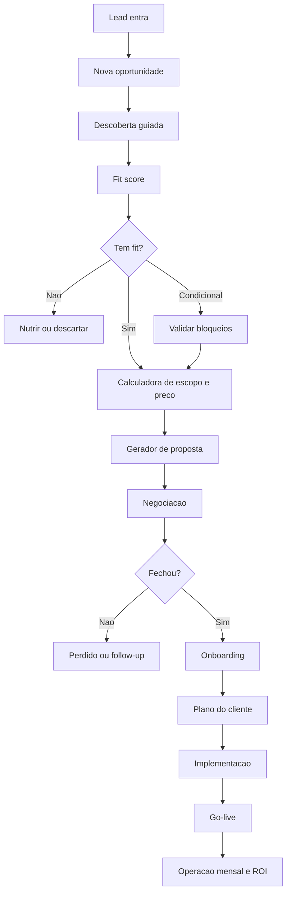

# Mapa do Produto MVP

## Ideia central

O `Gerador de Agentes IA` e uma ferramenta para transformar uma conversa comercial em diagnostico, proposta, onboarding, plano de implementacao e acompanhamento de ROI.

Ele nao deve ser apenas uma calculadora. A calculadora e uma parte. O produto completo precisa organizar a jornada inteira:

1. Entrada do lead.
2. Qualificacao comercial.
3. Diagnostico de fit.
4. Estimativa de escopo e preco.
5. Proposta.
6. Fechamento.
7. Onboarding.
8. Plano do cliente.
9. Implementacao.
10. Operacao mensal e ROI.

## Usuarios

### Pre-vendedor

Usa o sistema durante a primeira conversa. Precisa entender se existe dor real, volume suficiente, urgencia, dinheiro na mesa e capacidade do cliente de implementar.

### Closer

Usa o mapa da oportunidade para conduzir a reuniao de proposta. Precisa falar com base nas dores do cliente, nao com uma apresentacao generica.

### Implementador

Usa o plano de onboarding para criar agentes, conectar canais, configurar regras, testar fluxos e entregar a primeira versao em producao.

### CS ou Gestor da Conta

Usa o relatorio mensal para mostrar valor, acompanhar resultados, propor melhorias e justificar a mensalidade.

### Cliente

Em uma segunda fase, pode acessar um portal simples para ver pendencias, materiais enviados, plano aprovado, entregaveis e resultados.

## Proposta de valor

O sistema responde quatro perguntas que normalmente ficam soltas:

- Esse cliente tem fit?
- Quanto devemos cobrar?
- O que exatamente precisamos construir?
- Como provamos que esta fazendo sentido todo mes?

## Modulos do MVP

### 1. Dashboard Comercial

Lista oportunidades por etapa:

- Lead novo.
- Descoberta marcada.
- Diagnostico em andamento.
- Fit forte.
- Fit condicional.
- Proposta enviada.
- Negociacao.
- Fechado.
- Perdido.
- Sem fit agora.

Campos principais:

- empresa;
- contato;
- segmento;
- etapa;
- fit score;
- valor estimado;
- setup sugerido;
- mensalidade sugerida;
- responsavel;
- proxima acao.

### 2. Nova Oportunidade

Formulario curto para registrar o lead.

Campos:

- empresa;
- site;
- segmento;
- nome do contato;
- cargo;
- telefone;
- email;
- origem;
- tamanho da operacao;
- observacoes iniciais.

### 3. Descoberta Guiada

Roteiro usado na ligacao.

Blocos:

- contexto da empresa;
- dor principal;
- processo atual;
- volume;
- perdas;
- ferramentas;
- decisao;
- urgencia;
- expectativa;
- verba.

Saidas:

- resumo da dor;
- principais frases do cliente;
- dinheiro em jogo;
- risco de nao fazer;
- fit score.

### 4. Resultado de Fit

Tela de decisao.

Mostra:

- nota de fit de 0 a 100;
- classificacao;
- motivos do score;
- bloqueios criticos;
- recomendacao de proxima acao.

Regras:

- 75 a 100: Fit forte.
- 55 a 74: Fit condicional.
- 0 a 54: Sem fit agora.

Bloqueios criticos podem reduzir a recomendacao mesmo com score alto:

- cliente sem canal definido;
- cliente sem responsavel interno;
- dor sem impacto financeiro;
- expectativa impossivel;
- falta de acesso aos sistemas necessarios;
- resistencia total a mudar processo.

### 5. Calculadora de Escopo e Preco

Transforma diagnostico em escopo.

Calcula:

- numero de agentes;
- complexidade;
- horas de setup;
- custo interno;
- preco minimo;
- preco sugerido;
- prazo;
- mensalidade;
- margem;
- payback esperado.

### 6. Gerador de Proposta

Gera uma proposta consultiva.

Estrutura:

- contexto diagnosticado;
- dores principais;
- impacto financeiro;
- solucao proposta;
- escopo por agente;
- integracoes;
- cronograma;
- investimento;
- ROI esperado;
- proximos passos.

### 7. Onboarding do Cliente

Depois do fechamento, abre um formulario profundo.

Coleta:

- regras comerciais;
- perguntas de qualificacao;
- tom de voz;
- limites do agente;
- canais;
- CRM;
- base de conhecimento;
- arquivos;
- exemplos de conversas;
- criterios de sucesso.

### 8. Plano do Cliente

Documento gerado automaticamente a partir do onboarding.

Inclui:

- objetivo;
- dores;
- agentes;
- responsabilidades;
- regras;
- integracoes;
- materiais pendentes;
- plano de implementacao;
- checklist;
- metricas;
- riscos;
- entregaveis mensais.

### 9. Operacao Mensal e ROI

Tela para registrar resultados.

Metricas:

- conversas atendidas;
- leads qualificados;
- reunioes geradas;
- vendas influenciadas;
- horas economizadas;
- receita atribuida;
- perdas evitadas;
- custo mensal;
- ROI;
- proximas otimizacoes.

## Primeira versao realmente util

O primeiro MVP deve fazer bem estas coisas:

1. Cadastrar oportunidade.
2. Rodar descoberta guiada.
3. Calcular fit.
4. Calcular preco e prazo.
5. Gerar proposta em texto.
6. Rodar onboarding do cliente fechado.
7. Gerar plano do cliente.
8. Registrar resultados mensais.

Nao precisa ter portal do cliente no primeiro corte. Portal e fase 2.

## Fluxo macro

