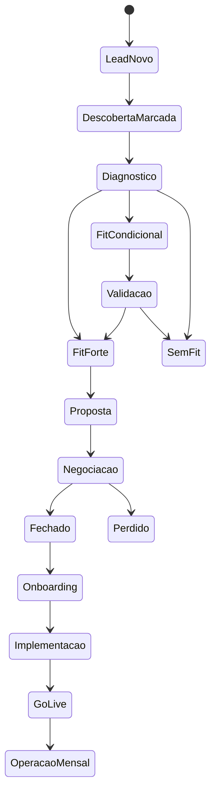

# Fluxos e Telas

## Navegacao principal

- Dashboard
- Oportunidades
- Nova oportunidade
- Descoberta
- Calculadora
- Propostas
- Onboarding
- Planos de clientes
- ROI mensal
- Parametros

## Tela 1: Dashboard

Objetivo: dar visao rapida do funil.

Componentes:

- cards de resumo;
- tabela de oportunidades;
- filtros por etapa, responsavel, segmento e fit;
- alertas de proximas acoes;
- oportunidades sem proxima acao;
- oportunidades com fit forte sem proposta.

Indicadores:

- oportunidades abertas;
- fit medio;
- setup potencial;
- mensalidade potencial;
- propostas enviadas;
- fechamentos;
- clientes em onboarding.

## Tela 2: Nova Oportunidade

Objetivo: registrar rapidamente um lead.

Campos:

- empresa;
- contato;
- cargo;
- WhatsApp;
- email;
- site;
- segmento;
- origem;
- problema inicial;
- responsavel interno;
- data da descoberta;
- observacoes.

Acao principal:

- `Iniciar descoberta`.

## Tela 3: Descoberta Guiada

Objetivo: conduzir a ligacao do pre-vendedor/closer.

Layout sugerido:

- coluna esquerda: perguntas;
- coluna direita: resumo vivo da oportunidade;
- rodape: salvar, pausar, gerar fit.

Blocos de perguntas:

1. Contexto da empresa.
2. Dor e urgencia.
3. Processo atual.
4. Volume e perdas.
5. Ferramentas e canais.
6. Decisao e verba.
7. Sucesso esperado.

Saidas automaticas:

- dor principal;
- impacto financeiro;
- fit score;
- frases fortes do cliente;
- possiveis agentes.

## Tela 4: Resultado de Fit

Objetivo: decidir o caminho comercial.

Mostra:

- nota geral;
- nota por criterio;
- classificacao;
- motivos;
- riscos;
- recomendacao.

Criterios:

- dor e prioridade;
- impacto economico;
- volume e repeticao;
- prontidao operacional;
- fit comercial.

Decisoes:

- seguir para proposta;
- pedir mais informacoes;
- nutrir para o futuro;
- desqualificar.

## Tela 5: Calculadora de Escopo

Objetivo: transformar diagnostico em preco.

Inputs:

- tipo de agente;
- quantidade de agentes;
- canais;
- integracoes;
- complexidade;
- volume mensal;
- turnos por conversa;
- tokens medios;
- margem desejada;
- taxa hora comercial;
- custo interno hora.

Outputs:

- horas estimadas;
- custo interno;
- preco minimo;
- preco sugerido;
- mensalidade minima;
- mensalidade sugerida;
- margem;
- payback.

## Tela 6: Gerador de Proposta

Objetivo: gerar uma proposta pronta para revisar.

Secoes editaveis:

- resumo executivo;
- problema;
- impacto;
- solucao;
- escopo;
- cronograma;
- investimento;
- ROI;
- proximos passos.

Controles:

- tom consultivo;
- tom direto;
- proposta enxuta;
- proposta completa;
- exportar PDF;
- copiar para documento.

## Tela 7: Onboarding do Cliente

Objetivo: coletar tudo que precisa para implementar.

Blocos:

- empresa;
- objetivo;
- dores;
- agentes;
- canais;
- CRM;
- conhecimento;
- tom de voz;
- regras;
- handoff;
- metricas;
- acessos;
- exemplos.

Funcionalidade importante:

- salvar parcialmente;
- marcar pendencias;
- anexar arquivos;
- gerar plano.

## Tela 8: Plano do Cliente

Objetivo: centralizar o que sera construido.

Secoes:

- resumo do cliente;
- objetivo do projeto;
- dores;
- agentes;
- fluxos;
- dados necessarios;
- integracoes;
- riscos;
- cronograma;
- entregaveis;
- metricas de sucesso.

Tambem deve ter uma `Nota do Projeto`, inspirada no exemplo visual:

- briefing completo;
- canais definidos;
- base enviada;
- integracoes aprovadas;
- regras de handoff;
- testes;
- ROI configurado.

## Tela 9: ROI Mensal

Objetivo: provar valor todo mes.

Campos:

- mes;
- conversas;
- leads qualificados;
- reunioes;
- vendas;
- receita;
- margem;
- horas economizadas;
- perdas evitadas;
- custo mensal;
- observacoes.

Resultados:

- impacto bruto;
- impacto liquido;
- ROI;
- payback;
- melhorias recomendadas.

## Estado ideal por oportunidade

