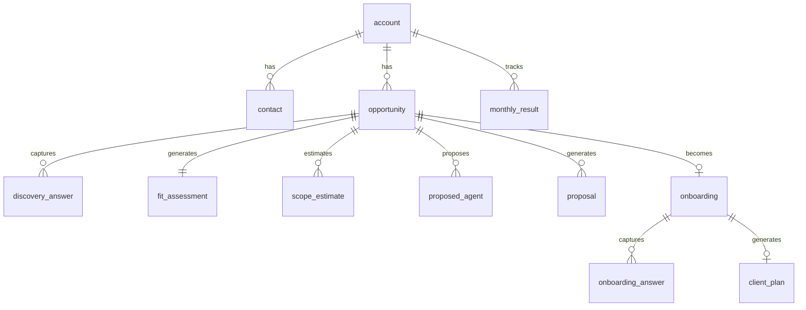

# Modelo de Dados

## Entidades principais

### account

Representa a empresa cliente ou oportunidade.

Campos:

- `id`
- `name`
- `site_url`
- `segment`
- `company_size`
- `monthly_revenue_estimate`
- `created_at`
- `updated_at`

### contact

Pessoa relacionada a uma empresa.

Campos:

- `id`
- `account_id`
- `name`
- `role`
- `email`
- `phone`
- `whatsapp`
- `is_decision_maker`

### opportunity

Oportunidade comercial.

Campos:

- `id`
- `account_id`
- `owner_id`
- `stage`
- `source`
- `pain_summary`
- `estimated_setup_price`
- `estimated_monthly_fee`
- `fit_score`
- `fit_classification`
- `next_action`
- `next_action_date`
- `created_at`
- `updated_at`

### discovery_answer

Respostas da ligacao de descoberta.

Campos:

- `id`
- `opportunity_id`
- `question_key`
- `question_label`
- `answer_text`
- `answer_number`
- `answer_option`
- `created_at`

### fit_assessment

Resultado do diagnostico de fit.

Campos:

- `id`
- `opportunity_id`
- `pain_priority_score`
- `economic_impact_score`
- `volume_repetition_score`
- `operational_readiness_score`
- `commercial_fit_score`
- `total_score`
- `classification`
- `blockers`
- `recommendation`

### scope_estimate

Estimativa de escopo.

Campos:

- `id`
- `opportunity_id`
- `agent_count`
- `channel_count`
- `integration_count`
- `complexity_level`
- `estimated_setup_hours`
- `internal_hourly_cost`
- `commercial_hourly_rate`
- `internal_cost`
- `minimum_price`
- `suggested_setup_price`
- `suggested_monthly_fee`
- `estimated_weeks`
- `gross_margin`

### proposed_agent

Agente proposto.

Campos:

- `id`
- `opportunity_id`
- `name`
- `role`
- `channel`
- `goal`
- `main_tasks`
- `handoff_rules`
- `knowledge_sources`
- `status`

### proposal

Proposta gerada.

Campos:

- `id`
- `opportunity_id`
- `version`
- `title`
- `executive_summary`
- `problem`
- `solution`
- `scope`
- `timeline`
- `investment`
- `roi_summary`
- `status`
- `created_at`

### onboarding

Processo apos fechamento.

Campos:

- `id`
- `opportunity_id`
- `account_id`
- `status`
- `kickoff_date`
- `target_go_live_date`
- `owner_id`
- `completion_score`

### onboarding_answer

Respostas do briefing profundo.

Campos:

- `id`
- `onboarding_id`
- `question_key`
- `question_label`
- `answer_text`
- `answer_file_url`
- `created_at`

### client_plan

Plano gerado para o cliente.

Campos:

- `id`
- `onboarding_id`
- `account_id`
- `objective`
- `pains`
- `agents`
- `implementation_plan`
- `deliverables`
- `success_metrics`
- `risks`
- `status`
- `created_at`

### monthly_result

Resultados mensais de operacao e ROI.

Campos:

- `id`
- `account_id`
- `month`
- `conversations`
- `qualified_leads`
- `meetings_booked`
- `sales_influenced`
- `attributed_revenue`
- `gross_margin_generated`
- `hours_saved`
- `avoided_loss`
- `monthly_fee`
- `token_cost`
- `third_party_cost`
- `total_cost`
- `gross_impact`
- `net_impact`
- `roi`
- `notes`

## Relacionamentos



## Campos calculados

### Fit score

```text
fit_score =
  pain_priority_score +
  economic_impact_score +
  volume_repetition_score +
  operational_readiness_score +
  commercial_fit_score
```

### Receita exposta

```text
exposed_revenue =
  monthly_leads *
  current_conversion_rate *
  average_ticket *
  estimated_leakage_rate
```

### Preco minimo

```text
minimum_price =
  internal_cost / (1 - target_gross_margin)
```

### Mensalidade sugerida

```text
suggested_monthly_fee =
  max(monthly_cost / (1 - margin_target), conservative_monthly_impact * value_capture_rate)
```

### ROI

```text
roi =
  (gross_impact - monthly_fee - operating_costs) / (monthly_fee + operating_costs)
```

## Status recomendados

### opportunity.stage

- `lead_novo`
- `descoberta_marcada`
- `diagnostico`
- `fit_forte`
- `fit_condicional`
- `sem_fit`
- `proposta`
- `negociacao`
- `fechado`
- `perdido`

### onboarding.status

- `aguardando_kickoff`
- `coletando_informacoes`
- `materiais_pendentes`
- `em_implementacao`
- `em_testes`
- `go_live`
- `operacao`

### proposed_agent.status

- `proposto`
- `aprovado`
- `em_construcao`
- `em_teste`
- `ativo`
- `pausado`

