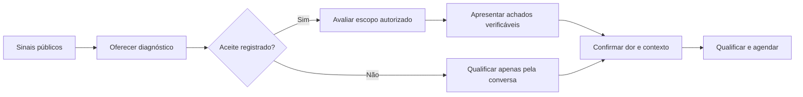

# Seis ALAs e matriz de qualificação

As ALAs são especializações do CORE-08, não cópias do núcleo. Todas recebem conta, participação, histórico, evidências e versão do playbook; retornam dados, resposta proposta e próxima etapa. Todas usam CORE-07 para enviar e CORE-09 para passagem. Falhas técnicas seguem CORE-12.

## ALA-01 · IA

**Gatilho e entradas:** roteamento para agentes IA ou intenção explícita; sinais públicos de atendimento, segmento e histórico.

- **ICP e dor:** negócios com atendimento comercial, agendamentos ou orçamentos; investigar demora, perda de acompanhamento e esforço repetitivo.
- **Perguntas:** como chegam os contatos? Quem atende? Qual volume aproximado? Onde há dificuldade? Quem avalia uma solução?
- **Oferta e abertura:** “Podemos avaliar com vocês o atendimento e identificar oportunidades de melhoria. Faz sentido conversar sobre isso?”
- **Decisões:** aceite registra contato, mensagem, data e escopo do teste. Revogação interrompe avaliação. Medir somente o observado no escopo; sem rubrica aprovada, apresentar medidas e achados sem score numérico agregado.
- **Objeção:** se já usa IA, perguntar onde ainda há lacunas; não presumir necessidade de substituir a solução.
- **Saída:** dor confirmada, contexto operacional, interlocutor e próximo passo acordado; comercial consultivo recebe resumo e eventual diagnóstico.
- **Exceções:** recusa ao diagnóstico não impede conversa voluntária. Sem dados, usar “não avaliado”; sem dor/fit, nutrição ou encerramento com motivo.

## ALA-02 · Infraestrutura

**Gatilho e entradas:** necessidade de capacidade, números ou ativos; perfil e estrutura conhecida.

**Sequência:** identificar operação → levantar estrutura atual → necessidade e quantidade → recorrência/prazo → cliente ou revendedor → passagem comercial.

- **ICP e dor:** operadores de WhatsApp, agências e revendedores com necessidade de fornecimento.
- **Perguntas:** quantos números operam? Qual estrutura/API utilizam? O que precisam adquirir? Em qual quantidade e prazo? É para uso próprio ou clientes?
- **Oferta e abertura:** “Como vocês organizam hoje a estrutura de WhatsApp e o fornecimento de novos números?”
- **Decisões:** demanda de fornecimento fica nesta ALA; desenho de continuidade passa para ALA-03; interesse em relação de parceria passa para ALA-05, mantendo histórico.
- **Objeção:** fornecedor atual é contexto para entender lacunas; não prometer disponibilidade ou desempenho sem confirmação.
- **Saída:** item necessário, quantidade/unidade, recorrência, prazo, tipo de comprador, interlocutor e próximo passo; comercial de infraestrutura.
- **Exceções:** catálogo/preço indisponível exige consulta humana; nenhuma venda ou compra automática.

## ALA-03 · Contingência

**Gatilho e entradas:** necessidade de continuidade, interrupções ou dependência de poucas linhas.

**Sequência:** mapear operação → dependências e incidentes → impacto → estrutura e urgência → responsáveis → diagnóstico técnico agendado.

- **ICP e dor:** operações em que parada de atendimento/vendas provoca impacto relevante.
- **Perguntas:** o que acontece quando uma linha para? Quantas pessoas/unidades dependem dela? Há redundância? Qual impacto e urgência? Quem responde pela operação?
- **Oferta e abertura:** “Se uma linha ficar indisponível, como a equipe mantém o atendimento?”
- **Decisões:** continuidade confirmada gera oportunidade consultiva; pedido apenas de números/ativos segue ALA-02.
- **Objeção:** estrutura existente leva à investigação de cobertura, sem presumir falha nem garantir ausência de bloqueios.
- **Saída:** dependência, impacto, estrutura atual, urgência, responsável e próximo passo; comercial técnico.
- **Exceções:** incidente urgente pode ser encaminhado imediatamente com qualificação incompleta; não simular suporte ou implantação concluída.

## ALA-04 · Disparos

**Gatilho e entradas:** interesse em operação de campanha e contexto da empresa.

**Sequência:** finalidade → base e público → volume/frequência → data → restrições → avaliação operacional humana.

- **ICP e dor:** empresas que precisam executar campanhas com escopo e prazos definidos.
- **Perguntas:** qual objetivo? Para qual público e base? Qual origem e disponibilidade dessa base? Quantos contatos? Qual frequência e data? Quais restrições operacionais?
- **Oferta e abertura:** “Qual campanha vocês precisam executar e para quando?”
- **Decisões:** briefing completo qualifica demanda; viabilidade, capacidade, condições e preço dependem da avaliação humana.
- **Objeção:** pedido imediato de preço leva à coleta mínima de escopo; não inventar cotação ou garantir entrega.
- **Saída:** finalidade, vertical, base/origem, volume, frequência, data, restrições, interlocutor e próximo passo; comercial com avaliação operacional.
- **Exceções:** data vencida exige atualização; base ou volume desconhecidos deixam briefing pendente. Não disparar a campanha do cliente neste flow.

## ALA-05 · Parceiros

**Gatilho e entradas:** perfil complementar ou intenção de indicar/revender.

**Sequência:** perfil → carteira e serviços → complementaridade → produtos → modelo de parceria → responsável humano.

- **ICP e dor:** agências, consultores, integradores, desenvolvedores e empresas de CRM que atendem clientes com necessidades complementares.
- **Perguntas:** quem vocês atendem? O que entregam hoje? Onde precisam de complemento? Preferem indicar ou revender? Qual oportunidade inicial enxergam?
- **Oferta e abertura:** “Quais demandas de automação ou WhatsApp seus clientes pedem que vocês ainda não atendem?”
- **Decisões:** classificar indicação ou revenda como interesse, sem firmar acordo. Demanda de compra imediata pode ser encaminhada à ALA de produto, encerrando a abordagem anterior.
- **Objeção:** perguntar preferências comerciais, sem prometer comissão, exclusividade ou marca branca não aprovadas.
- **Saída:** perfil, carteira/público, serviços atuais, produto complementar, modelo pretendido, interlocutor e próximo passo; responsável de parcerias.
- **Exceções:** sem carteira confirmada, registrar estágio e potencial como hipótese. Cadastro qualificado não equivale a parceiro aprovado.

## ALA-06 · Fornecedores

**Gatilho e entradas:** fornecedor encontrado ou apresentação recebida; serviço e origem.

**Sequência:** serviço → preço e unidade → capacidade → SLA e condições → referências → avaliação humana → eventual teste → decisão humana.

- **ICP e necessidade:** fornecedores de capacidade, números, ativos ou execução de operações pertinentes à Avraham.
- **Perguntas:** o que fornece? Qual preço/unidade e validade? Qual capacidade por período? Quais condições e SLA? Que histórico ou referências podem ser verificados?
- **Oferta e abertura:** “Estamos mapeando fornecedores. Pode compartilhar serviço, capacidade e condições para avaliação?”
- **Decisões:** registrar dados declarados separados dos verificados. Somente humano autoriza teste, compra e homologação. Sem rubrica e histórico verificado, não calcular score de confiabilidade.
- **Objeção:** referências indisponíveis ficam como lacuna explícita para compras; não converter declaração em comprovação.
- **Saída:** serviço, cotação/unidade/moeda/validade, capacidade/período, SLA, condições, referências ou ausência declarada, interlocutor e próximo passo; compras/operações.
- **Exceções:** fornecedor permanece em avaliação enquanto houver evidências pendentes. Sua cotação não vira custo realizado nem receita no dashboard.

## Matriz de passagem

| ALA | Evidência mínima adicional ao interlocutor e próximo passo | Destino | Registro resultante |
|---|---|---|---|
| IA | Dor confirmada e contexto operacional; aceite somente se houver diagnóstico | Comercial consultivo | Oportunidade de IA |
| Infraestrutura | Item, quantidade/unidade, prazo, recorrência e tipo de comprador | Comercial de infraestrutura | Oportunidade de fornecimento |
| Contingência | Dependência, impacto, estrutura, urgência e responsável operacional | Comercial técnico | Oportunidade consultiva |
| Disparos | Finalidade, vertical, base/origem, volume, frequência, data e restrições | Comercial/operações | Oportunidade com briefing |
| Parceiros | Perfil, carteira/público, serviços, produto complementar e modelo | Parcerias | Candidato a parceiro |
| Fornecedores | Serviço, cotação, capacidade, SLA, condições e situação das referências | Compras/operações | Avaliação de fornecedor |

Pedido explícito de humano pode interromper qualquer sequência antes da matriz completa. Nessa situação, a passagem informa `qualification_complete=false` e as lacunas; não contabiliza qualificado. Não há reunião obrigatória para toda ALA.

## Versionamento dos playbooks

Cada campanha fixa uma versão contendo ICP, dores, perguntas, objeções, oferta, scripts, evidências/cases, preços, FAQ e roteamento. Este documento fornece o conteúdo inicial de qualificação e abertura. Cases, preços, comissões e promessas específicas não foram fornecidos: ficam indisponíveis até publicação por responsável comercial. Pergunta sobre conteúdo indisponível vai ao humano. Atualizações não reescrevem o histórico de versões já utilizadas.
