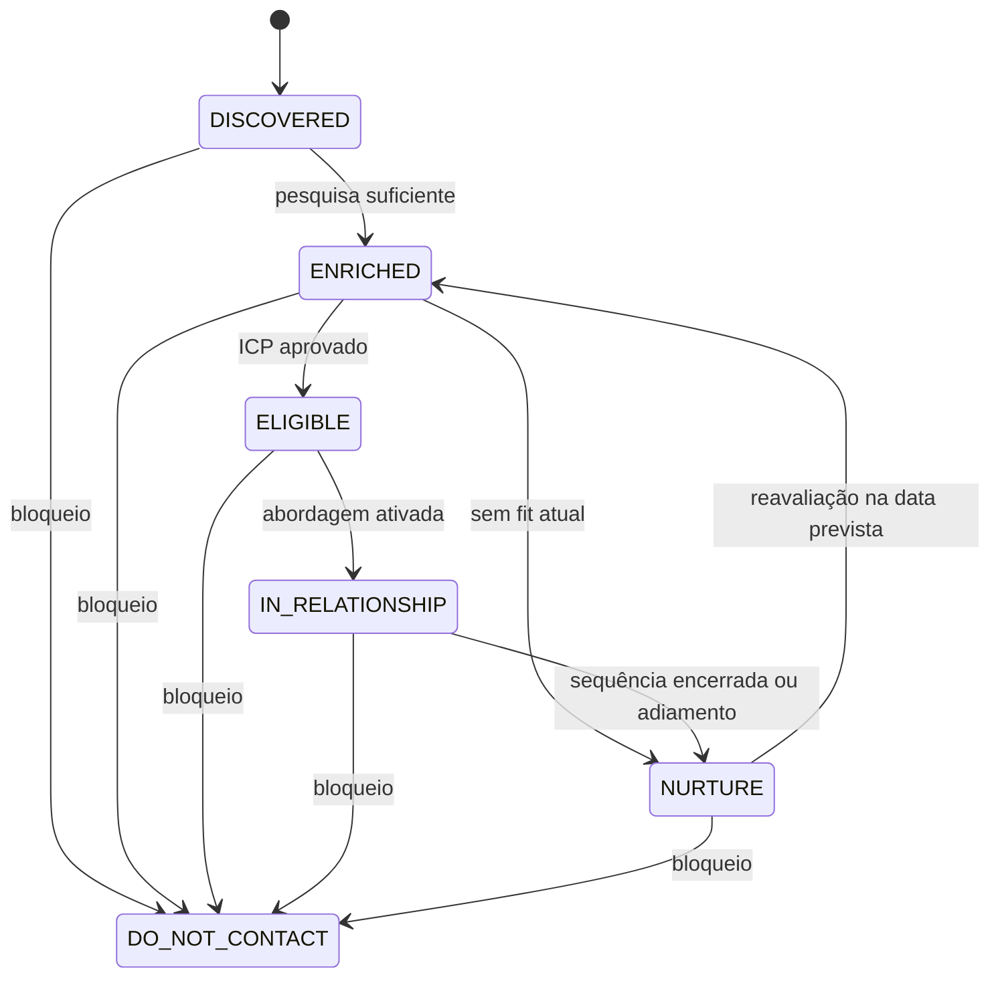

# Dados, identidade e estados

Modelo lógico, sem escolha de banco ou migração nesta entrega. Identificadores internos são estáveis e independentes dos IDs dos provedores.

## Entidades e autoridade

| Entidade | Dados e relações essenciais | Autoridade |
|---|---|---|
| Conta | ID, nome, CNPJ/domínio, estado, fontes, evidências, produtos possíveis | Núcleo para identidade e elegibilidade; CRM para proprietário comercial |
| Contato | ID, conta, nome/função, canais e identificadores externos | Núcleo e CRM por mapeamento de campos |
| Campanha | ID/versão, ALA, ICP, oferta, sequência, limites, janela e responsável | Núcleo |
| Participação | Conta, campanha/versão, produto, progresso, estado e abordagem ativa | Núcleo |
| Conversa | Conta, contatos, mensagens, ALA, controle bot/humano e responsável | Núcleo; humano libera retomada |
| Mensagem | ID, conta, conversa, ação, canal, direção, provedor, horários e status | Núcleo a partir de eventos do provedor |
| Oportunidade | Conta, produto, campanha de origem, responsável, etapa e próximo passo | CRM |
| Parceiro | Conta, modelo pretendido, avaliação e oportunidades indicadas | Responsável de parcerias via CRM |
| Fornecedor | Conta, serviços, cotações, capacidade, evidências e homologação | Compras/operações via CRM |
| Resultado financeiro | ID externo, oportunidade, campanha, moeda, GMV, receita, custos e completude | Lançamento validado recebido via CRM |
| Evento/ação | Envelope, chave idempotente, versão, processamento e tentativas | Núcleo |

Uma conta pode ter vários contatos e oportunidades históricas. Vários canais da mesma pessoa apontam para o mesmo contato quando houver evidência de vínculo. Uma conversa lógica reúne o histórico de todos os canais da abordagem.

## Identidade

- CNPJ: apenas dígitos, preservando a unidade identificada. Domínio: host normalizado sem protocolo, caminho ou prefixo `www`; domínio de rede social não identifica empresa.
- Telefone: normalizar com código de país quando conhecido; ausência de país não autoriza inferência ambígua.
- CNPJ idêntico é chave forte. Domínio corporativo exclusivo pode vincular conta se não houver conflito de CNPJ. Domínio compartilhado por unidades/grupo exige revisão.
- Telefone, nome e cidade geram candidatos a correspondência; isoladamente não autorizam fusão, pois números podem ser compartilhados ou reatribuídos.
- Se chaves apontarem para contas diferentes, suspender abordagem dos candidatos envolvidos até resolver a identidade. Fusão preserva fontes, histórico e IDs antigos como aliases.
- Restrição única/controle transacional deve impedir duas contas para a mesma chave forte e duas abordagens ativas para a mesma conta. A verificação antes de inserir, sozinha, não basta.

## Estados separados

`DO_NOT_CONTACT` não tem saída automática. Remoção exige ação humana explícita, motivo e evidência de autorização para retomada; volta para reavaliação, sem envio imediato. Pendências técnicas e de identidade são campos operacionais, não etapas comerciais.

| Dimensão | Estados e transições |
|---|---|
| Mensagem de saída | SCHEDULED → SENT → DELIVERED → RESPONDED; SCHEDULED/SENT → FAILED quando falha confirmada; SCHEDULED → CANCELLED quando ação impedida |
| Mensagem recebida | Registrada com direção INBOUND e horário; não percorre os estados de envio |
| Oportunidade | QUALIFICATION → MEETING (se houver) → PROPOSAL → NEGOTIATION → WON/LOST; etapas opcionais podem ser puladas por ação do CRM |
| Fornecedor | IDENTIFIED → IN_REVIEW → TEST_PENDING → APPROVED/REJECTED; decisão direta em revisão só por humano com justificativa |
| Participação | PENDING → ACTIVE → PAUSED/COMPLETED/CANCELLED; PAUSED → ACTIVE somente após liberação e revalidação |
| Campanha | DRAFT → READY → ACTIVE → PAUSED/FINISHED; PAUSED → ACTIVE após revalidação |
| Controle de conta | AUTOMATION → HUMAN quando passada; HUMAN → AUTOMATION apenas por liberação explícita; BLOCKED prevalece sobre ambos |

Confirmações parciais podem chegar fora de ordem: recibo de entrega comprova envio mesmo sem evento SENT anterior. Guardar os fatos/horários e derivar o status mais avançado confirmado; não regredir RESPONDED com entrega atrasada. Resposta sem vínculo inequívoco a uma mensagem é atribuída à conversa, sem marcar arbitrariamente todas as mensagens como respondidas. Resultado de transporte incerto fica em campo de reconciliação e não vira FAILED automaticamente.

Reuniões têm registro próprio de marcação, realização, cancelamento ou ausência; não são inferidas apenas pela etapa MEETING. WON/LOST pertencem à oportunidade e não removem a conta. Reabertura de oportunidade terminal exige evento explícito do CRM com motivo. Nutrição exige data e motivo, mas não remove bloqueio nem posse humana.

## Exclusividade e ordem dos eventos

1. CORE-06 adquire uma reserva exclusiva por conta ao ativar a abordagem; novas participações ficam PENDING.
2. Cada ação carrega a versão do controle da conta. Recebimento de resposta incrementa essa versão, pausa cadência e cancela ações ainda não enviadas.
3. Antes da chamada externa, CORE-07 valida novamente reserva, versão, horário, limite e bloqueios. Comandos simultâneos são serializados por conta.
4. Uma chamada já aceita pelo provedor não pode ser desfeita por resposta/opt-out posterior. Registrar essa corrida; impedir todos os próximos envios. Nenhum teste deve prometer cancelar o que já saiu.
5. Passagem ativa HUMAN antes da sincronização com CRM; CRM indisponível não devolve controle à IA. Opt-out ativa BLOCKED e cancela todas as ações pendentes da conta.
6. Trocar ALA exige concluir/cancelar participação anterior e criar a próxima atomicamente, preservando resumo. Uma pausa mantém a reserva para impedir que outra campanha contorne a conversa ativa.

## Relação com o modelo anterior

`ICP_APPROVED` corresponde a elegibilidade; `ACTIVE_OUTREACH` a conta em relacionamento com participação ACTIVE. `RESPONDED`/`POSITIVE_REPLY` tornam-se eventos de conversa. `QUALIFIED`, reuniões, proposta, negociação e venda são dados da oportunidade. Preservar o histórico original em eventual migração futura, sem converter automaticamente um status legado em evidência que nunca foi registrada.
