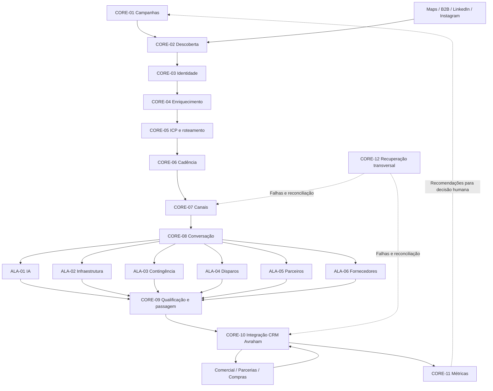

# Máquina Comercial Avraham — Arquitetura dos Flows

Versão do desenho: 1.0 · Data: 2026-09-07 · Status: especificação documental.

Um núcleo de aquisição, dados e comunicação atende seis ALAs especializadas. A automação descobre, pesquisa, aborda, conversa, qualifica e agenda. O humano assume propostas, negociação, fechamento, compras e homologação de fornecedores.

## Como navegar

| Documento | Conteúdo |
|---|---|
| [Catálogo do núcleo](CORE.md) | Gatilhos, entradas, decisões, saídas e falhas dos 12 flows centrais |
| [ALAs e qualificação](ALAS.md) | Seis sequências especializadas e playbooks operacionais iniciais |
| [Dados e estados](DATA_STATES.md) | Entidades, identidade, transições, exclusão mútua e controle da conversa |
| [Contratos de integração](CONTRACTS.md) | Eventos, canais, CRM, agenda e recuperação |
| [Mensuração](METRICS.md) | Fórmulas, atribuição e resultados financeiros |
| [Validação e implantação](VALIDATION.md) | Cenários de aceite, ondas e dependências reais |

## Diagrama geral

Os blocos compartilham persistência lógica de contas e eventos. O diagrama mostra dependências de negócio; não exige uma cadeia síncrona. CORE-12 atende falhas de todos os blocos. Cadência inicia a abordagem; o hub usa o mesmo adaptador de canais para responder, sem reativar a cadência.

## Decisões fixadas

- WhatsApp é o canal principal; LinkedIn e Instagram têm adaptadores próprios.
- Uma conta tem no máximo uma abordagem ativa, inclusive quando possuir vários contatos ou produtos possíveis.
- Resposta pausa a prospecção; passagem ao humano pausa toda resposta automática; não contato prevalece sobre ambos.
- Diagnóstico de atendimento exige aceite registrado. Sinais públicos geram hipóteses, não conclusões sobre falhas internas.
- As seis ALAs fazem parte do desenho. A implantação começa pelo núcleo e ALA IA.
- Referência inicial: 50 novas contas admitidas por dia, contabilizadas após deduplicação, no fuso America/Sao_Paulo. Não equivale a 50 envios; excedentes ficam pendentes.
- Cada campanha define sua sequência e limites antes de ser habilitada. Não existe cadência de envio implícita.
- Receita e lucro bruto são medidos separadamente. V1 recomenda alocação, mas não altera volumes automaticamente.

## Compatibilidade e limites

Este pacote prevalece sobre definições conflitantes das pastas 00–15. O antigo ATIVOS corresponde à ALA-02 Infraestrutura; o antigo INFRA deve ser separado por intenção entre ALA-02 e ALA-03. Estados de reunião/venda antes listados na conta passam à oportunidade; status de entrega pertence à mensagem. Isso é um mapeamento conceitual, não uma migração executada.

Os JSONs de Google Maps, enriquecimento e Pipedrive existentes são referências de componentes. Os exports Disparai são referências de conversação em outro formato. A cópia local `avrahamcrm-main.zip` não confirmou uma API disponível; os contratos deste pacote são requisitos, não endpoints existentes.

Não foram criados workflows executáveis, banco, credenciais, integrações, envios ou deploy. Provedor, persistência física e interfaces reais serão fechados na etapa de implementação técnica.
