# Workflow V2 — Enriquecimento, Diagnóstico e Outbound

> Fonte operacional para o sistema comercial. O fluxo começa por uma lista externa ou por descoberta automatizada e termina em reunião, venda e diagnóstico entregue ao prospect.

## 1. Princípio

O sistema não deve prospectar apenas por segmento. Ele deve encontrar sinais públicos e comportamentais que indiquem três coisas:

1. **Fit**: a empresa tem perfil econômico e operacional compatível com a oferta.
2. **Dependência do WhatsApp**: o WhatsApp parece ser um canal relevante de atendimento ou venda.
3. **Dor observável**: há sinais de demora, ausência de automação, ausência de follow-up ou baixa eficiência comercial.

A máquina transforma esses sinais em prioridade comercial.

## 2. Fluxo visual

```mermaid
flowchart LR
    A{Origem} -->|Lista importada| B[Normalizar + deduplicar]
    A -->|Google Maps| C[Scraping / descoberta]
    A -->|LinkedIn / outro workflow| C
    C --> B

    B --> D[Enriquecimento público]
    D --> E[ICP Score]
    E --> F{ICP mínimo?}
    F -->|não| G[Arquivar / nutrir]
    F -->|sim| H[Detectar WhatsApp + canais]

    H --> I{WhatsApp disponível?}
    I -->|não| J[Outro canal / fila de enriquecimento]
    I -->|sim| K[Contato diagnóstico permitido]

    K --> L[Escutar resposta e timestamps]
    L --> M{Resposta automática provável?}
    M -->|sim| N[Automation Signal ↑ / Pain ↓]
    M -->|não| O[Medir tempo real de resposta]

    O --> P[Análise da conversa]
    N --> P
    P --> Q[Estimativas operacionais + contexto de mercado]
    Q --> R[Pain Score + Opportunity Score]

    R --> S{Prioridade comercial?}
    S -->|baixa| T[Arquivar / reavaliar]
    S -->|alta| U[Gerar diagnóstico comercial]
    U --> V[Abordagem personalizada]
    V --> W{Respondeu?}
    W -->|não| X[Follow-up]
    X --> W
    W -->|sim| Y[Qualificação + reunião]
    Y --> Z[Proposta / venda]
    Z --> AA[Delivery: diagnóstico]
    AA --> AB[Métricas + aprendizado]
    AB -. retroalimenta .-> E
    AB -. ajusta .-> R
    AB -. melhora .-> V
```



## 3. Entradas

O workflow aceita múltiplas origens. A origem é um adaptador, não uma regra central do negócio.

### 3.1 Lista importada

CSV, XLSX, API B2B ou saída de outro workflow.

Campos aceitos quando existirem:

- razão social / nome fantasia;
- CNPJ;
- telefone;
- WhatsApp;
- site;
- Instagram;
- LinkedIn;
- cidade/UF;
- CNAE / segmento;
- número de funcionários;
- porte;
- origem.

### 3.2 Descoberta automatizada

Fontes previstas:

- Google Maps;
- LinkedIn;
- mecanismos de busca;
- diretórios setoriais;
- APIs B2B;
- outros workflows.

Cada origem deve registrar `source_type`, `source_name`, `source_query` e `collected_at`.

## 4. Enriquecimento

O objetivo é preencher o máximo de contexto antes do primeiro contato.

### 4.1 Sinais públicos de capacidade econômica

Não existe um único dado público que revele faturamento mensal com precisão. O sistema deve trabalhar com **proxies**, cada um com evidência e confiança.

Exemplos:

- número de unidades;
- quantidade de avaliações no Google;
- frequência de avaliações recentes;
- preço público de produtos/serviços;
- presença de catálogo;
- quantidade de vendedores/atendentes públicos;
- vagas abertas;
- número de funcionários quando disponível;
- tráfego/site e atividade digital quando disponível;
- frequência de publicações;
- volume aparente de oferta;
- quantidade de canais de atendimento;
- anúncios ativos ou sinais de mídia paga, quando observáveis legalmente;
- porte/CNAE quando disponível.

O sistema nunca transforma proxy em fato. Exemplo:

```json
{
  "signal": "google_reviews_90d",
  "value": 184,
  "interpretation": "alto volume de atividade aparente",
  "confidence": 0.72,
  "source": "google_maps"
}
```

## 5. ICP dinâmico

O ICP precisa ser configurável por nicho e aprender com vendas reais.

### 5.1 Dimensões iniciais

| Dimensão | Pergunta | Peso inicial |
|---|---|---:|
| Segment fit | Está em um nicho que já sabemos atender? | 20% |
| Revenue capacity proxy | Há sinais de capacidade de compra? | 25% |
| WhatsApp dependency | WhatsApp parece relevante na jornada? | 25% |
| Lead volume proxy | Há sinais de volume de atendimento? | 15% |
| Case similarity | Temos case parecido e comprovado? | 10% |
| Reachability | Conseguimos chegar ao canal/decisor? | 5% |

### 5.2 Dependência do WhatsApp

Sinais possíveis:

- botão de WhatsApp no site;
- link `wa.me`;
- CTA “fale no WhatsApp”;
- WhatsApp na bio;
- Google Business apontando WhatsApp/telefone comercial;
- catálogo do WhatsApp;
- campanhas e landing pages encaminhando para WhatsApp;
- mensagens públicas do tipo “chame no WhatsApp”;
- links de rastreamento terminando em WhatsApp;
- ausência de checkout e predominância de venda consultiva.

Produzir `whatsapp_dependency_score` de 0 a 100 com evidências.

## 6. Contato diagnóstico

O sistema mede o atendimento apenas em interações permitidas e verdadeiras. Não deve inventar identidade, urgência, orçamento, condição pessoal ou intenção de compra inexistente.

Quando houver um cenário legítimo de mystery shopping autorizado, registrar essa autorização no lead/campanha.

### 6.1 Dados obrigatórios

- timestamp de envio;
- timestamp de primeira resposta;
- tempo em segundos/minutos;
- mensagem recebida;
- canal;
- classificação provável: humano, automação, híbrido, indeterminado;
- confiança da classificação.

### 6.2 Janela configurável

Valores iniciais:

- 5 minutos;
- 15 minutos;
- 60 minutos;
- 6 horas;
- 24 horas;
- 72 horas.

Esses limites devem ficar em configuração por nicho, nunca hardcoded.

## 7. Detecção de automação

A hipótese "respondeu rápido = tem IA" é insuficiente. O sistema precisa combinar sinais.

### Sinais de automação provável

- resposta em poucos segundos de forma consistente;
- mensagem idêntica em diferentes horários/testes autorizados;
- menu numerado;
- palavras-chave rígidas;
- resposta incompatível com a pergunta;
- saudação/template muito estruturado;
- transição explícita para atendente;
- identificação do bot;
- comportamento 24/7.

### Resultado

```json
{
  "automation_probability": 0.86,
  "automation_type": "chatbot_rules|ai_agent|hybrid|human|unknown",
  "evidence": [],
  "confidence": 0.81
}
```

Uma resposta rápida não elimina o lead automaticamente. A análise deve verificar se a automação é boa, limitada, apenas triagem ou se ainda existe espaço comercial.

## 8. Diagnóstico da operação

A IA analisa:

- tempo até primeira resposta;
- tempo entre mensagens;
- atendimento fora de horário;
- personalização;
- entendimento da intenção;
- perguntas de qualificação;
- tentativa de venda;
- tentativa de agendamento;
- clareza de preço quando aplicável;
- follow-up;
- persistência;
- qualidade geral;
- indícios de bot/IA;
- gargalo principal.

## 9. Estimativas de impacto

O sistema pode estimar impacto econômico, mas precisa separar claramente:

- **dado observado**;
- **dado informado pelo prospect**;
- **benchmark de mercado**;
- **hipótese calculada**.

Nunca apresentar estimativa como fato.

### 9.1 Variáveis

```text
estimated_daily_inbound_leads
estimated_response_delay_loss_rate
estimated_average_ticket
estimated_conversion_rate
estimated_lost_leads_per_day
estimated_lost_revenue_monthly
```

### 9.2 Prioridade das fontes

1. dado fornecido pelo próprio prospect;
2. dado público do negócio;
3. case interno comparável;
4. benchmark setorial documentado;
5. hipótese conservadora.

### 9.3 Exemplo

```text
20 contatos/dia × 8% de perda estimada por atraso = 1,6 oportunidades/dia
1,6 × ticket estimado de R$ 350 = R$ 560/dia de receita potencial em risco
```

O relatório deve mostrar intervalo, por exemplo `R$ 8 mil–R$ 16 mil/mês`, e a confiança da estimativa.

## 10. Pain Score

O `Pain Score` mede oportunidade de melhoria, não "qualidade moral" do atendimento.

### Pesos iniciais

| Sinal | Peso |
|---|---:|
| Tempo de primeira resposta | 25% |
| Ausência/baixa automação útil | 20% |
| Falta de follow-up | 20% |
| Baixa condução comercial | 15% |
| Falta de qualificação | 10% |
| Experiência inconsistente | 10% |

## 11. Opportunity Score

```text
Opportunity Score =
ICP Score × 35%
+ Pain Score × 40%
+ WhatsApp Dependency × 15%
+ Case Similarity × 10%
```

Pesos versionados por experimento.

## 12. Diagnóstico gerado para venda

Cada lead priorizado recebe um artefato de diagnóstico com:

1. resumo executivo;
2. evidências observadas;
3. tempo de resposta;
4. automação provável;
5. pontos de perda de conversão;
6. estimativa de impacto com premissas;
7. oportunidade de automação/IA;
8. case mais parecido e comprovado;
9. recomendação;
10. CTA para reunião.

## 13. Abordagem comercial

A mensagem usa fatos reais e hipóteses identificadas como hipóteses.

Estrutura:

```text
contexto específico
→ evidência observada
→ impacto provável
→ case comparável
→ convite curto para revisar o diagnóstico
```

Exemplo de lógica, não copy final:

```text
"Analisei o fluxo de atendimento da empresa e identifiquei um intervalo de X minutos até a primeira resposta. Em operações parecidas, esse atraso costuma criar perda de oportunidade principalmente quando o lead está comparando fornecedores. Montei um diagnóstico curto com os pontos encontrados e um case nosso parecido. Posso te mostrar em 15 minutos?"
```

## 14. Conversão

Estados mínimos:

```text
imported
→ enriched
→ icp_qualified
→ diagnostic_pending
→ under_observation
→ diagnosed
→ prioritized
→ outreach_sent
→ replied
→ meeting_scheduled
→ meeting_held
→ proposal_sent
→ won | lost | nurture | do_not_contact
```

## 15. Delivery

O diagnóstico não é apenas isca de prospecção. Quando houver reunião, ele vira um entregável real.

Saídas:

- resumo visual;
- timeline do atendimento;
- tempos medidos;
- gargalos;
- estimativas e premissas;
- automações recomendadas;
- plano de implantação em alto nível.

## 16. Aprendizado

O sistema deve aprender quais sinais realmente antecipam reunião e venda.

Exemplos:

- empresas com WhatsApp Dependency > 80 convertem mais?
- atraso > 60 min correlaciona com reunião?
- qual Pain Score mínimo faz sentido?
- qual origem gera mais receita?
- qual nicho converte melhor?
- qual case aumenta resposta?
- áudio ou texto converte melhor?

O objetivo é substituir regras intuitivas por regras calibradas com dados próprios.
