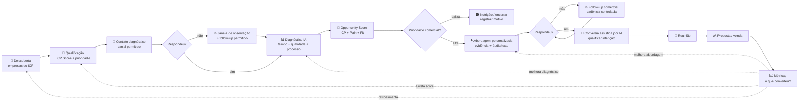

# Workflow Autônomo de Diagnóstico e Outbound

> Documento operacional principal. O sistema deve executar o ciclo **Descobrir → Qualificar → Observar → Diagnosticar → Priorizar → Abordar → Converter → Medir → Aprender**.

## Visão visual



## Objetivo do sistema

Criar uma máquina comercial que não trate todos os leads como iguais. Antes de investir esforço comercial, o sistema coleta sinais do negócio, mede o atendimento quando houver uma interação válida, identifica evidências de dor e transforma isso em uma prioridade comercial.

O resultado esperado não é simplesmente gerar mensagens. É gerar **reuniões e receita a partir de empresas com problema observável e aderência ao ICP**.

## Ciclo central

```text
OBSERVAR
  ↓
DECIDIR
  ↓
AGIR
  ↓
MEDIR
  ↓
APRENDER
  ↓
ADAPTAR
  ↺
```

Cada ação gera um evento. Cada evento alimenta os KPIs. Os KPIs alteram prioridades, hipóteses e experimentos.

---

## Etapa 1 — Descoberta

**Entrada:** segmento, região, fonte e filtros de ICP.

**Fontes possíveis:** Google Maps, listas B2B, Instagram, LinkedIn, bases próprias, indicações e outras fontes permitidas.

**Dados mínimos:**

- nome da empresa;
- domínio/site;
- telefone comercial;
- WhatsApp comercial, quando público;
- Instagram/LinkedIn;
- segmento;
- cidade/UF;
- origem do lead;
- sinais públicos de porte e operação;
- data da descoberta.

**Regras:**

- deduplicar antes de criar;
- respeitar `do_not_contact`;
- registrar origem;
- nenhum lead avança sem identificador único.

**Saída:** `discovered`.

---

## Etapa 2 — Qualificação de ICP

O sistema calcula um `ICP Score` de 0 a 100.

### Dimensões iniciais

| Dimensão | Peso inicial |
|---|---:|
| Segmento prioritário | 25% |
| Porte/sinais de capacidade de compra | 20% |
| Dependência de atendimento comercial | 20% |
| Presença e atividade digital | 15% |
| Compatibilidade com cases existentes | 10% |
| Facilidade de contato/decisor | 10% |

### Resultado

- `80–100`: ICP A
- `60–79`: ICP B
- `40–59`: ICP C
- `<40`: não priorizar

**Saída:** `qualified`, `review_required` ou `disqualified`.

---

## Etapa 3 — Contato diagnóstico

O objetivo é obter um sinal real do processo de atendimento sem inventar identidade, relação comercial, urgência ou intenção de compra inexistente.

O sistema pode avaliar interações reais, públicas, autorizadas ou iniciadas de forma verdadeira. A mensagem deve ser simples e compatível com o contexto do canal.

### Eventos obrigatórios

- `diagnostic_contact_sent`
- `first_reply_received`
- `response_time_measured`
- `followup_received`
- `conversation_closed`

### Dados observados

- tempo até primeira resposta;
- qualidade da primeira resposta;
- personalização;
- perguntas de descoberta;
- tentativa de condução para próximo passo;
- tentativa de agendamento;
- clareza da oferta;
- follow-up;
- tempo entre follow-ups;
- abandono.

**Saída:** `under_observation`.

---

## Etapa 4 — Janela de observação

Não concluir o diagnóstico apenas pela primeira mensagem.

### Marcos iniciais

- T+1h
- T+6h
- T+24h
- T+72h
- T+7d, quando o ciclo do segmento justificar

A janela é configurável por nicho.

**Saída:** `ready_for_diagnosis`.

---

## Etapa 5 — Diagnóstico por IA

A IA transforma eventos e mensagens em um diagnóstico estruturado. Ela deve separar **fato observado** de **inferência**.

### Dimensões

1. velocidade de resposta;
2. qualidade da abertura;
3. personalização;
4. descoberta da necessidade;
5. clareza comercial;
6. condução para próximo passo;
7. tentativa de agendamento;
8. follow-up;
9. persistência adequada;
10. experiência geral.

### Saída mínima

```json
{
  "response_time_minutes": 137,
  "response_quality_score": 55,
  "qualification_score": 30,
  "followup_score": 0,
  "scheduling_score": 20,
  "overall_service_score": 34,
  "pain_score": 76,
  "problem_detected": true,
  "evidence": [
    "Primeira resposta após 137 minutos",
    "Nenhum follow-up nas 72 horas seguintes"
  ],
  "main_problem": "tempo de resposta e ausência de follow-up",
  "recommended_solution": "agente de IA para atendimento e recuperação"
}
```

A IA não pode afirmar que a empresa "atende mal" sem evidência registrada.

**Saída:** `diagnosed`.

---

## Etapa 6 — Opportunity Score

Três componentes:

- `ICP Score`: capacidade e aderência;
- `Pain Score`: intensidade da dor observada;
- `Timing/Intent Score`: sinais de oportunidade atual, quando existirem.

### Fórmula inicial

```text
Opportunity Score =
(ICP Score × 0,40) +
(Pain Score × 0,50) +
(Timing Score × 0,10)
```

Se não houver dado suficiente de timing, redistribuir o peso entre ICP e Pain em vez de inventar valor.

### Faixas

| Score | Prioridade | Ação |
|---:|---|---|
| 80–100 | A | abordar agora |
| 60–79 | B | abordar dentro da cadência |
| 40–59 | C | nutrir / reavaliar |
| <40 | D | não abordar |

**Saída:** `prioritized`.

---

## Etapa 7 — Geração da abordagem

A abordagem é produzida a partir de evidência, não de uma apresentação genérica da empresa.

### Contexto obrigatório

- nome/segmento;
- evidência observada;
- consequência comercial plausível;
- case compatível e comprovado, quando houver;
- solução aplicável;
- CTA de baixo atrito.

### Estrutura

```text
Contexto específico
→ evidência concreta
→ impacto provável
→ referência/case compatível
→ convite curto para conversar
```

### Regras

- não inventar números;
- não inventar cases;
- não atribuir perda financeira sem base;
- não usar informação privada obtida indevidamente;
- não abrir com currículo institucional;
- respeitar opt-out imediatamente.

**Saída:** `outreach_ready`.

---

## Etapa 8 — Abordagem comercial

Canais possíveis: WhatsApp, Instagram, LinkedIn ou outro canal permitido para o lead.

Estratégia inicial no WhatsApp:

```text
Mensagem curta
→ contexto
→ áudio ou texto personalizado
→ CTA
```

Registrar:

- canal;
- variante;
- texto/áudio utilizado;
- horário;
- resposta;
- latência;
- sentimento/intenção;
- próxima ação.

**Saída:** `contacted` ou `waiting_reply`.

---

## Etapa 9 — Follow-up

Follow-up existe para recuperar oportunidade, não para insistência infinita.

### Cadência inicial para teste

- D0: abordagem
- D2: follow-up 1
- D5: follow-up 2
- D10: follow-up final

O sistema deve permitir que cada nicho tenha sua própria cadência.

Se houver `opt_out`, encerrar imediatamente e marcar `do_not_contact`.

---

## Etapa 10 — Conversa e qualificação

Quando o lead responde, o objetivo é levá-lo ao próximo passo adequado.

### Intenções mínimas

- `interested`
- `asked_info`
- `asked_pricing`
- `objection`
- `not_interested`
- `not_the_decision_maker`
- `wants_meeting`
- `opt_out`
- `needs_human`

### Ações possíveis

- responder;
- perguntar;
- enviar prova/case;
- tratar objeção;
- agendar reunião;
- agendar follow-up;
- escalar para humano;
- encerrar.

**Saída:** `replied`, `interested`, `meeting_scheduled` ou `closed`.

---

## Etapa 11 — Reunião, proposta e venda

Na reunião, registrar no mínimo:

- dor confirmada;
- impacto;
- prioridade;
- solução indicada;
- ticket proposto;
- objeções;
- próximo passo;
- data esperada de decisão.

Estados:

`meeting_scheduled → meeting_held → proposal_sent → won/lost`

---

## Etapa 12 — Medição e aprendizado

A operação deve responder continuamente:

> **Qual perfil, evidência, mensagem, canal e cadência produzem mais receita?**

### North Star inicial

**Receita gerada por 100 empresas analisadas.**

### Funil principal

```text
Empresas descobertas
→ ICP aprovados
→ diagnosticadas
→ dor detectada
→ prioridade A/B
→ abordadas
→ responderam
→ reuniões
→ propostas
→ vendas
→ receita
```

### Conversões obrigatórias

- descoberta → ICP aprovado;
- ICP aprovado → diagnóstico concluído;
- diagnóstico → dor relevante;
- prioridade A/B → resposta comercial;
- resposta → reunião;
- reunião → proposta;
- proposta → venda;
- abordagem → venda;
- empresa analisada → venda.

### Economia unitária

- custo por empresa analisada;
- custo por oportunidade A;
- custo por resposta;
- custo por reunião;
- CAC;
- receita por 100 analisadas;
- margem por venda, quando disponível.

---

## Estados do workflow

```text
discovered
qualified
under_observation
ready_for_diagnosis
diagnosed
prioritized
outreach_ready
contacted
waiting_reply
replied
interested
meeting_scheduled
meeting_held
proposal_sent
won
lost
closed
do_not_contact
review_required
```

Estado de funil e estado de execução devem ser campos separados. Uma falha de integração não deve alterar o estágio comercial do lead.

---

## Retroalimentação

Resultados reais atualizam:

1. pesos do ICP;
2. pesos do Pain Score;
3. critérios de prioridade;
4. melhor janela de envio;
5. melhor mensagem inicial;
6. melhor formato, texto ou áudio;
7. melhor cadência;
8. nichos com melhor retorno;
9. cases com maior efeito;
10. volume necessário para a meta mensal.

Nenhum ajuste automático pode apagar histórico. Toda versão de regra, score, prompt e mensagem precisa ser auditável.
